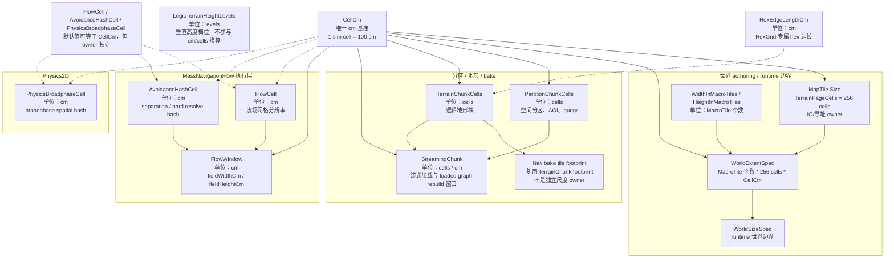

# 空间尺度配置查表

本页是 `gitbook/architecture/spatial-scale-and-resolution-ssot.md` 的快速查表入口。权威概念、owner 与映射以架构页为准；本页只解释“看到某个配置/常量时，它是什么意思、用在哪里、不能和什么混用”。主表中带「#1567 切 1 已迁移」标注的行是历史键位，现行键位见文末[「四域归位目标键位」](#四域归位目标键位1567)。

交互式关系图见 [`spatial-scale-explorer.html`](spatial-scale-explorer.html)，用于点击查看“谁用谁做单位”、哪些尺度必需、哪些尺度可配置。Mod 作者地图尺度入门见 [`map-scale-authoring-guide.md`](map-scale-authoring-guide.md) 与 [`map-scale-authoring-starter.html`](map-scale-authoring-starter.html)。

## 单位依赖图

| 配置 / 常量 | 目标概念 | 单位 | 当前默认 | 含义 / 应用场景 | owner / 约束 |
|---|---|---:|---:|---|---|
| `SpatialScaleDefaults.CellCm` | `CellCm` | cm | 100 | 全局原子尺度。board 世界尺寸、nav bake cm 换算、默认 flow/hash cell 都从它解释。 | 唯一基准单位，必须 > 0。 |
| `Boards[].Grid.CellSizeCm` | `CellCm` | cm | 100 | 板内方格边长。格数是厘米矩形除以这个边长，向下取整。运行时从 `BoardConfig.GridCellSizeCm` 读取。 | 必须 > 0。 |
| `Boards[].Hex.EdgeLengthCm` | `HexEdgeLengthCm` | cm | 400 | Hex / HexGrid 板的六边形边长。能放进矩形的整圈留下。 | 仅六边形板生效；Grid / NodeGraph 写了就加载失败。必须 > 0。 |
| `MapTile.Size` | `TerrainPageCells` | cells | 256 | 256-cell IO/寻址地形数据页。世界大小的 `WidthInMacroTiles` / `HeightInMacroTiles` 以它为倍率。 | `MapTile.Size` 是 owner；`SpatialScaleDefaults.TerrainPageCells` 只引用它。 |
| `BoardConfig.WidthInMacroTiles`、`WidthCells` | 历史键 | —— | —— | 曾用来写板宽。出现即加载失败。 | 现行写法：`Boards[].WidthCm`。host world 由根板锚定。 |
| `BoardConfig.HeightInMacroTiles`、`HeightCells` | 历史键 | —— | —— | 曾用来写板高。出现即加载失败。 | 现行写法：`Boards[].HeightCm`。 |
| `WorldExtentSpec` | `WorldExtent` | cm | derived | 运行时由根板 `BoardExtentSpec` 直构、boot 由 `GameConfig.World` 直构（#1567），地形数据页数为派生 IO 细节，产出 runtime `WorldSizeSpec`。 | 是计算对象，不替换 `WorldSizeSpec`。 |
| `BoardConfig.ChunkSizeCells` | `PartitionChunkCells` | cells | 64 | 空间分区、AOI、query backend 的分区块边长。只描述查询分区，不描述地形或 navmesh。`World.Tuning.PartitionChunkCells` 声明后为唯一预算（#1567 切 4 已落地），板级字段已退役（JSON 出现即 fail-fast，运行时由 Tuning 回填）。 | 必须 > 0 且为 2 的幂。 |
| `VertexChunk.ChunkSize` | `TerrainChunkCells` | cells | 64 | 逻辑地形块边长。当前 navmesh tile footprint 等于 `TerrainChunk` footprint。 | 当前固定；#286 已把 grid/hex 地形输入统一到 `LogicTerrainField`。 |
| Nav bake tile footprint | `TerrainChunk` footprint | cells / cm | 64 cells | navmesh `.ntil` 的 tile 覆盖一个 `TerrainChunk`。 | 不再单独命名为尺度 owner；不要把 `NavTile` 当第二个 chunk 尺度。 |
| streaming / loaded graph window | `StreamingChunk` | cells / cm | derived | 流式加载、loaded graph rebuild 的空间窗口。 | 从 board 分区或显式配置推导；禁止私有 loader fallback。 |
| `MassNavigationFlowSolverConfig.fieldWidthCm` / `fieldHeightCm` | `FlowWindow` | cm | preset 显式配置 | MassNavigationFlow 执行层滑窗/工作区尺寸。 | 必须 > 0，并被 `FlowCell` 与 `AvoidanceHashCell` 整除。 |
| `MassNavigationFlowSolverConfig.flowCellSizeCm` | `FlowCell` | cm | preset 常用 100 | MassNavigationFlow 流场网格分辨率。 | 必须 > 0；不要和 board `CellCm` 混成同一个配置 owner。 |
| `MassNavigationFlowSolverConfig.separationHashCellSizeCm` | `AvoidanceHashCell` | cm | preset 常用 100 | MassNavigationFlow 分离邻居哈希 cell。 | 必须 > 0；属于 avoidance，不属于 navmesh bake。 |
| `MassNavigationFlowSolverConfig.hardResolveHashCellSizeCm` | `AvoidanceHashCell` | cm | preset 常用 50 | MassNavigationFlow 硬解析候选哈希 cell。 | 必须 > 0；可小于 `CellCm`，但必须由配置显式给出。 |
| `SpatialScaleDefaults.PhysicsBroadphaseCellCm` | `PhysicsBroadphaseCell` | cm | 100 | Physics2D broadphase spatial hash 默认尺度。 | 显式配置 / 命名常量，禁止缺失时静默 fallback。 |
| `SpatialScaleDefaults.LogicTerrainHeightLevels` | logic terrain height levels | levels | 16 | 逻辑地形高度档位数量，当前为 4-bit 高度域。 | owner 在 `SpatialScaleDefaults`；最大值为 `LogicTerrainMaxHeightLevel`。 |

迁移规则：

- `WidthInTiles` / `HeightInTiles`、`WidthInMacroTiles` / `HeightInMacroTiles`、`WidthCells` / `HeightCells`、`GridCellSizeCm`、`OriginXCm` / `OriginYCm`、`WidthHexes` / `HeightHexes`、`HexEdgeLengthCm` 都是历史字段；出现即加载失败。现行写法是 `Boards[].WidthCm` / `HeightCm`、`Grid.CellSizeCm`、`Hex.EdgeLengthCm`、`Anchor`。无板图的世界范围仍写 `World.WidthCm` / `HeightCm`。
- #283 进行破坏式迁移，旧键出现即 fail-fast，不提供别名兼容。
- 编辑器让作者输入目标米数，落盘为厘米矩形 `Boards[].WidthCm` / `HeightCm` 和 `Grid.CellSizeCm`；不要让作者手填 TerrainChunk 或 NavTile 个数。
- `WorldExtentSpec` 是 authoring/计算对象，产出既有 `WorldSizeSpec`；不要替换 `WorldSizeSpec`。
- `HexEdgeLengthCm` 只用于 HexGrid board 的 hex 几何；不要拿它解释 Grid board cell、FlowCell 或 NavTile footprint。
- `NavTile footprint` 是 `TerrainChunk` 的用途，不是独立尺度 owner。
- `PartitionChunk` 只用于空间分区/AOI/query；不要拿它解释 terrain/navmesh tile。
- `TerrainPage`（地形数据页） 只用于 IO/寻址地形数据页和世界范围 authoring；不要拿它解释 streaming chunk 或 terrain chunk。
- 障碍数据源仍使用 `ManifestationObstacleIntent2D` + `ShapeDataStorage2D` + `CompoundObstacle2DState`。

## 群体模拟

群体模拟的格不从 `CellCm` 派生。权威定义在架构页层级表的 `NavCell`、`NavTile`（群体）、`FogCell`、`AvoidanceHashCell`。导航格边长写在 `Navigation/navmesh.json` 的能力档 `profiles[].cellSizeCm`。其余标准参数在 `mods/capabilities/navigation/CrowdSimulationStandardMod/assets/CrowdSimulationConfig.json`，文件不再带 `version`。下表的旧键出现即失败。怎么拆 Mod、怎么覆盖、时钟写在哪，见架构页「作者怎么配」。

| 配置 | 目标概念 | 单位 | 标准值 | 含义 / 约束 |
|---|---|---:|---:|---|
| `profiles[].cellSizeCm` | `NavCell` | cm | 6250 | 导航格边长。每边数 = 板宽 ÷ 边长，16..1024，不进配置。板格 `Boards[].Grid.CellSizeCm` 不参与这条换算。 |
| `navtile.sizeCm` | `NavTile`（群体） | cm | 100000 | 导航 tile 边长，也是 HPA 的一块。整除导航格边长；派生格数 4..128；整除每边导航格数。地形 navmesh 的 64 板格足迹是另一行。 |
| `fog.cellSizeCm` | `FogCell` | cm | 25000 | 群体迷雾格边长。≥ 100 cm，整除导航格边长，派生倍数 1..32。主干 Vision 的迷雾格写在 `assets/Vision/fog_layers.json` 的 `fog_layers[].cellSizeCm`，owner 分开。 |
| `navmesh.minRegionNavCellArea` | 区域阈值 | 导航格² | 12 | 栅格算法量，数字是格数。 |
| `navmesh.maxSimplificationErrorNavCells` / `maxEdgeLenNavCells` / `portalInsetNavCells` | 轮廓 / portal | 导航格 | 1.3 / 12 / 0.5 | 栅格算法量。 |
| `hpa.maxEntranceWidthNavCells` | HPA 入口 | 导航格 | 6 | 边界扫描格数。旧键 `hpa.clusterSize` 已删除，边长改 `navtile.sizeCm`。 |
| `flowfield.corridorPaddingNavTiles` | 走廊外扩 | 导航 tile | 1 | tile 掩码外扩。 |
| `movement.maxStepNavCells` | 子步上限 | 导航格 | 0.45 | 防穿格。 |
| `structures.portalReachNavCells` | 桥头 | 导航格 | 4 | 腐蚀半径。 |
| `profiles[].jump.rangeNavCells` | 跳跃 | 导航格 | 按能力档 | 写在 `Navigation/navmesh.json`。与 `.navsurface` 候选的格距比较。 |
| `formation.magicBoxPadCm` | 点选框外扩 | cm | 6250 | 世界厘米，与包围盒厘米坐标比较。 |
| `spawn.navCellInsetFraction` | 格内缩进 | 比例 | 0.02 | 0..1。 |
| `formation.slotSightCm` / `leaderLookAheadCm` / `slotArriveCm` / `goalArriveCm` / `settleRadiusCm` / `minClumpCm` | 阵型距离 | cm | 100000 / 37500 / 2187.5 / 6250 / 12500 / 9375 | 装载时 `厘米 / profiles[].cellSizeCm`，再 `Fix64.FromDouble`。 |
| `formation.magicBoxMaxSpreadCm` | 点选框最大跨度 | cm | 250000 | 直接当厘米用，`Fix64.FromDouble`。 |
| `movement.wakeDistanceCm` | 唤醒 | cm | 12500 | 装载时 `厘米 / profiles[].cellSizeCm`，再 `Fix64.FromDouble`。 |
| `deploy.spreadCm` / `baseJitterCm` | 部署散布 | cm | 187500 / 125000 | 装载时 `厘米 / profiles[].cellSizeCm`，再 `Fix64.FromDouble`。 |
| `fog.visionCm` / `fog.eyeCm` | 视野 / 眼高 | cm | 80000 / 1000 | 视野半径相对迷雾格有上限。 |
| `spawn.groupSpacingScale` | 团间距 | 无量纲 | 2.2 | 乘个人半径。旧键 `spawn.clusterSpacing`。 |
| `formations.<id>.spacingDiameterScale` / `formation.spacingScale` | 间距倍率 | 无量纲 | 1 或 1.8 / 1.1 | 乘直径或个人间距。键是阵型 id。 |
| `movement.laneSpreadSpeedRatio` | 车道展开 | 速度比 | 0.5 | 乘速度。 |
| `movement.blendRatePerSec` / `stallDecayPerSec` | 混合 / 卡住衰减 | 1/仿真秒 | 2.5 / 0.5 | `min(1, rate × dt)`；卡住计时按 `dt × stallDecayPerSec` 衰减。 |
| `formation.leaderTurnRatePerSec` | 领队转向 | 1/仿真秒 | 3 | `min(1, dt × leaderTurnRatePerSec)`。 |
| `avoidance.accelerationPerSec` | 分离加速 | 1/仿真秒 | 4 | `1 − exp(−accelerationPerSec × dt)`，dt 为子步仿真秒。 |
| `movement.unitTurnRateRadPerSec` | 单位转向 | 弧度/仿真秒 | 2.5 | `unitTurnRateRadPerSec × dt`。 |
| `movement.slotCheckIntervalSubSteps` | 槽位视线检查 | 子步 | 4 | 每隔这么多子步查一次，按单位句柄错峰。 |

旧键 `movement.blendRate`、`movement.stallDecay`、`formation.leaderTurnRate`、`avoidance.acceleration`、`movement.unitTurnRate`、`movement.slotCheckInterval` 出现即失败。

避让哈希格 `CrowdSpatialHash.CellSizeCm` / `CellsPerSide` 由半径和 `avoidance.hashRings` 派生，没有边长配置键。

## 四域归位目标键位（#1567）

空间配置按世界/板/导航/执行四域归位后，authoring 键位与 owner 如下；各切合入前现状键仍生效，旧键在新键生效后 fail-fast。

| 域 | 目标键 | 单位 | 含义 | 取代的现状键 |
|---|---|---|---|---|
| 世界（host world） | map `RootBoard`（缺省第一块板） | 板名 | 有板图根板锚定；无板图 game.json `world` | 地形数据页数量键 |
| map | `Tuning.PartitionChunkCells` / `LoadedChunkCapacity` | cells / 个 | map 级分区与 streaming 预算，可选 override；缺省分区 64、容量 256（SpatialScaleDefaults） | `Boards[].ChunkSizeCells` / `LoadedChunkCapacity` |
| 板 | `Boards[].WidthCm` / `HeightCm` + `Grid.CellSizeCm` | cm | 厘米矩形。格数向下取整 | `WidthCells` 与地形数据页数换算 |
| 板 | `Boards[].Hex.EdgeLengthCm` | cm | 六边形边长。个数是矩形里能放下的整圈 | `WidthHexes` / `HexEdgeLengthCm` |
| 板 | `Boards[].Anchor` | cm | 格子角 = `World − Local`。根板 `World` 为 `(0, 0)`。卫星矩形必须落在根板内 | 板恒居中，或 `OriginXCm` / `OriginYCm` |
| 导航 | navmesh.json `boards.<name>.source` | —— | 烘焙源（.height 直采 / .grid / .hex），板是可选源之一 | bake 从板 LogicTerrain 投影的现状链路（#1350 直采方向） |
| 导航 | navmesh.json `maps.<mapId>.boards.<name>`（tileWorldWidthCm/tileWorldHeightCm） | cm | 每板导航瓦片颗粒度（nav 自有，与 cell/chunk 解耦）；瓦片数由板范围÷瓦片尺寸派生 | 板内 `NavTileGrid`（已迁出，出现即 fail-fast） |
| 执行 | `MassNavigationConfig.json` 各键 | cm | 不变 | —— |

四域边界三句话：世界尺寸不由板决定；板是业务区域不是性能分区；nav 瓦片颗粒度与板无关。
